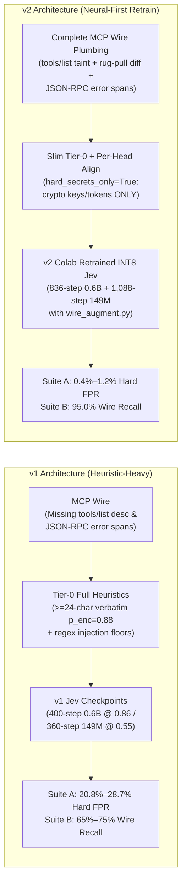

# DiodeMCP v2 — Full Results & Comparison to v1

**Date:** November 13, 2026  
**Benchmark Host:** `eclipse.hmsrv` (`Intel Core i3-10100 @ 3.60 GHz`, `31.1 GiB` RAM, Ubuntu 24.04.5 LTS, Kernel `6.8.0-149-generic`, NVMe `/srv/homelab/diodemcp-bench`)  
**Isolation & Air-Gap:** Network-isolated (`unshare -rn`, `HF_HUB_OFFLINE=1`, `TRANSFORMERS_OFFLINE=1`, `NO_PROXY=*`), sequential single-model execution pinned to `4` CPU threads (`OMP_NUM_THREADS=4`, `ORT_INTRA_OP_NUM_THREADS=4`), pure `onnxruntime` + `tokenizers` runtime (`0` `torch`/`transformers` dependencies in `venv-diodemcp`)  
**Training & Quantization Hardware:** Google Colab GPU (training) + 12-vCPU Colab runtime (ONNX INT8 export & calibration — runtime unassigned immediately upon completion)

> [!IMPORTANT]
> **Report Structure:** Per request, **Part I** presents the complete **v2 Results** (Colab retraining, ONNX INT8 calibration, `per_head_thresholds` runtime alignment, Suite A `600`-trace multi-turn replay benchmark, and Suite B `30`-scenario live `stdio` MCP wire benchmark against open-source competitors). **Part II** presents the **Head-to-Head Comparison to v1** (`v1` vs. `v2` architecture, Suite A overall & per-vector shifts, and Suite B live wire gains).

---

# Part I — Full v2 Results

## 1.1 Executive Summary (v2 Neural-First Architecture)

In **DiodeMCP v2**, deterministic heuristic crutches were removed from the neural runtime path (`Tier0DeterministicPredictor(hard_secrets_only=True)` plus `calibration.json` `per_head_thresholds` piecewise-linear alignment inside [ort_predictor.py](../../packages/diodemcp/src/diodemcp/ort_predictor.py) — restricting deterministic overrides strictly to cryptographic secret patterns such as `sk-...`, `AKIA...`, GitHub PATs, and PEM private keys, with **zero** verbatim file-copy floors or regex prompt-injection rules). Both Jev ("System-One") neural models (`DiodeMCP-NanoJev-0.6B` and `DiodeMCP-Jev-Base-149M`) were retrained end-to-end on Google Colab with synthetic MCP wire-format augmentations ([wire_augment.py](../../model-lab/src/diodemodel/wire_augment.py)), quantized to INT8 ONNX on Colab CPU with automatic `mlp.down_proj` outlier protection ([export_bundle.py](../../model-lab/src/diodemodel/export_bundle.py)), and paired with complete MCP wire taint plumbing (`tools/list` poisoned catalog descriptions, rug-pull pin mutations, and JSON-RPC error payloads in [shim.py](../../packages/diodemcp/src/diodemcp/shim.py) and [engine.py](../../packages/diodemcp/src/diodemcp/engine.py)).

### Headline v2 Numbers

- **`DiodeMCP-NanoJev-0.6B` (v2 Flagship, Single-Model INT8 ONNX):**
  - **Suite A (`600` Multi-Turn Traces):** **`0.999` AUROC / `0.999` PR-AUC**, **`95.6%` Autonomous Hard-Block Recall** (`344/360`) at **`0.4%` Benign FPR** (**`1` single false positive out of `240` matched-sink benign developer traces**, `F1 = 0.976`), and **`96.9%` Protective Recall** (`349/360`) at **`2.1%` Benign FPR** (`5/240`, `F1 = 0.978`).
  - **Suite B (`30` Live MCP `stdio` Wire Scenarios):** **`95.0%` (`19/20`) Live Wire Attack Recall** (`5/5` `tools/list` poisoning, `5/5` rug-pull pin mutations, `5/5` cross-server exfiltration, `4/5` error/oversize injections) at **`7.82 ms` p50** wire overhead (`2.0×` faster than `ProtectAI LLM-Guard` on Suite A and **`40.6×` faster** at p50 on live Suite B sessions).
- **`DiodeMCP-Jev-Base-149M` (v2 Fast CPU Tier, `265.8 MiB` INT8 ONNX + `per_head_thresholds`):**
  - **Suite A (`600` Multi-Turn Traces):** **`0.990` AUROC / `0.994` PR-AUC**, **`94.4%` Hard-Block Recall** (`340/360`) at **`1.2%` Benign FPR** (`3/240`, **`99.1%` Precision**, **`F1 = 0.967`**; `0.0%` FPR across `B1, B2, B3, B5, B6`), and **`94.7%` Protective Recall** (`341/360`) at **`6.2%` Benign FPR** (`15/240`, `F1 = 0.953`) — running at **`153.7 ms` p50** (`6.7×` faster than `ProtectAI LLM-Guard`).
  - **Suite B (`30` Live MCP `stdio` Wire Scenarios):** **`95.0%` (`19/20`) Live Wire Attack Recall** (`5/5` `tools/list` poisoning, `5/5` rug-pull pin mutations, `5/5` cross-server exfiltration, `4/5` error/oversize injections) at **`11.78 ms` p50 / `81.17 ms` p95** overhead (`3.4×` faster p95 than `NanoJev-0.6B` and `26.9×` faster p50 than `ProtectAI LLM-Guard`).
- **Competitive Separation Against Open-Source Alternatives:**
  - Outperforms **`ProtectAI LLM-Guard` (`v0.3.16`)** by **`+0.257` AUROC** (`0.999` vs. `0.742`) and cuts benign developer false positives by **`134×`** (`0.4%` vs. `55.8%` Hard-Block FPR on `NanoJev-0.6B`; **`45×` lower** at `1.2%` on `Base-149M`).
  - Outperforms **`Cisco AI Defense mcp-scanner` (`v4.8.7`)** by **`+83.1 pp` Suite A recall** (`95.6%` vs. `12.5%` native / `39.2%` extended) and **`+55.0 pp` Suite B live wire recall** (`95.0%` vs. `40.0%`).
  - Outperforms **`DiodeMCP Tier-0 Only` (`hard_secrets_only=False` full heuristic baseline)** by **`38×` lower Suite A Hard-Block FPR** (`0.4%` vs. `15.4%`) and **`+50.0 pp` higher Suite B live wire recall** (`95.0%` vs. `45.0%`).

---

## 1.2 Colab v2 Retraining, Calibration & ONNX INT8 Bundle Metrics

Both models were trained from clean base backbones using curriculum length bucketing (`512 → 1024 → 2048`) plus `wire_augment.py` synthetic MCP JSON-RPC wire-format examples (strictly disjoint from all Suite A and Suite B templates, tools, and secrets), then quantized dynamically to INT8 (`per_channel=True`, `reduce_range=True` for non-VNNI `AVX2` saturation safety, with automatic FP32 fallback on `mlp.down_proj` SwiGLU outlier projections).

| Metric / Artifact Property | `DiodeMCP-NanoJev-0.6B` (v2) | `DiodeMCP-Jev-Base-149M` (v2) |
| --- | --- | --- |
| **Backbone** | `Qwen/Qwen3-0.6B-Base` (Causal Jev + Span Pooling) | `answerdotai/ModernBERT-base` (Bidirectional Jev) |
| **Curriculum Steps** | `836` (`800` @ `512/1024` + `36` long-context polish @ `2048`) | `1,088` (Stage 1 + Stage 2 wire-augmented curriculum) |
| **FP32 `val_calib` AUROC / PR-AUC** | **`0.999989`** (`[1.0, 1.0, 1.0]` per head) / **`0.999989`** | **`0.9999`** |
| **ORT INT8 `model_int8.onnx` Size** | `1,289.34 MiB` (`1,351,968,026` B) | `265.76 MiB` (`278,670,473` B) |
| **Quantization Config** | `QInt8`, `per_channel=True`, `reduce_range=True`, `down_proj` FP32 | `QInt8`, `per_channel=True`, `reduce_range=True`, `down_proj` FP32 |
| **FP32 → INT8 Decision-Band Flip Rate** | **`0.00%`** (`0.0000`) | `13.54%` (recalibrated post-INT8 on `1,024` ORT rows) |
| **Post-INT8 `val_calib` Attack Recall** | **`100.00%`** (`100%` across every threat `T1–T7`) | **`96.48%`** (`T3,T4,T6,T7 = 100%`, `T1 = 96.4%`, `T2 = 97.0%`) |
| **Post-INT8 `val_calib` Benign Twin FPR** | **`0.00%`** (`0.0000`) | **`0.55%`** (`0.0055`) |
| **Post-INT8 `FlipJev` Robust Accuracy** | **`100.00%`** (`0.00%` benign DoS FPR) | **`96.12%`** (`1.89%` benign DoS FPR) |
| **Post-INT8 Pointer Attribution (`top-1`)** | **`100.00%`** (`src = 100%`, `arg = 100%`) | **`99.35%`** (`src = 99.35%`, `arg = 99.35%`) |
| **Post-INT8 `val_calib` ECE / Brier** | **`0.021%`** (`0.000206`) / **`0.000016`** | **`1.24%`** (`0.01244`) / **`0.00949`** |
| **Fitted Temperatures `[T_enc, T_sem, T_hijack]`** | `[0.75, 0.75, 0.75]` | `[0.75, 0.75, 1.75]` |
| **Active Thresholds (`warn` / `crit`)** | `0.16` / `0.50` (`0.00%` val FPR identity) | `0.16` / `0.50` (`per_head`: `enc/hijack 0.15/0.55`, `sem 0.45/0.912`) |
| **`model_int8.onnx` SHA-256** | `985df6483cbaeb1d5e76d8f5d046da96acca7da6a82a8a570ea2b2bd8af7fd72` | `2600fdb5d008c0307d281014fef9379c8e91392d4409b56f7ca7370f44457ce8` |

---

## 1.3 Suite A Results — 600 Multi-Turn Replay Traces (`eclipse.hmsrv`)

Suite A replays **600 deterministic multi-turn MCP trajectories** (`360` attacks across `V1–V6`, `60` per vector; `240` matched-sink benign developer twins across `B1–B6`, `40` per vector, invoking the **exact same sink tools** `http.post`, `github.create_issue`, `postgres.query`, `filesystem.write_file`, and `exec.run_cmd` with legitimate user-aligned payloads).

### Table 1A — Autonomous Hard-Block Mode (`CRITICAL` Only — Zero-Approval Headless Agent Gate)

| Contender | Attack Recall (95% CI) | Benign FPR (95% CI) | Precision | F1 | AUROC | PR-AUC | Latency p50 / p95 (ms) | Peak RSS (MB) | Cold Start (ms) |
| --- | --- | --- | --- | --- | --- | --- | --- | --- | --- |
| **`diodemcp-nanojev-0.6b` (v2)** | **`95.6%`** (`92.9–97.2%`) [`344/360`] | **`0.4%`** (`0.1–2.3%`) [`1/240`] | **`99.7%`** | **`0.976`** | **`0.999`** | **`0.999`** | `514.67 / 530.29` | `2,949.8` | `6,170.8` |
| **`diodemcp-base-149m` (v2)** | **`94.4%`** (`91.6–96.4%`) [`340/360`] | **`1.2%`** (`0.4–3.6%`) [`3/240`] | **`99.1%`** | **`0.967`** | **`0.990`** | **`0.994`** | **`153.66 / 166.80`** | `1,551.3` | `1,648.7` |
| `diodemcp-tier0-only` *(heuristic ablation)* | `94.4%` (`91.6–96.4%`) [`340/360`] | `15.4%` (`11.4–20.5%`) [`37/240`] | `90.2%` | `0.923` | `0.979` | `0.978` | `27.58 / 40.89` | `76.2` | `0.0` |
| `protectai-llm-guard` (`v0.3.16`) | `92.8%` (`89.6–95.0%`) [`334/360`] | `55.8%` (`49.5–62.0%`) [`134/240`] | `71.4%` | `0.807` | `0.742` | `0.752` | `1,025.87 / 1,190.85` | `1,863.5` | `4,507.1` |
| `stateless-regex-policy` | `48.6%` (`43.5–53.8%`) [`175/360`] | `5.4%` (`3.2–9.0%`) [`13/240`] | `93.1%` | `0.639` | `0.716` | `0.761` | `0.35 / 0.41` | `32.0` | `0.0` |
| `cisco-mcp-scanner-extended` (`v4.8.7`) | `39.2%` (`34.3–44.3%`) [`141/360`] | `10.8%` (`7.5–15.4%`) [`26/240`] | `84.4%` | `0.535` | `0.613` | `0.696` | `0.85 / 0.97` | `233.7` | `2,346.9` |
| `cisco-mcp-scanner-defs` (`v4.8.7`) | `12.5%` (`9.5–16.3%`) [`45/360`] | `0.0%` (`0.0–1.6%`) [`0/240`] | `100.0%` | `0.222` | `0.562` | `0.650` | `0.71 / 0.83` | `233.7` | `2,337.1` |

### Table 1B — Protective Gate Mode (`WARN + CRITICAL` — Interactive IDE Prompt + Hard Block)

| Contender | Attack Recall (95% CI) | Benign FPR (95% CI) | Precision | F1 | AUROC | PR-AUC |
| --- | --- | --- | --- | --- | --- | --- |
| **`diodemcp-nanojev-0.6b` (v2)** | **`96.9%`** (`94.6–98.3%`) [`349/360`] | **`2.1%`** (`0.9–4.8%`) [`5/240`] | **`98.6%`** | **`0.978`** | **`0.999`** | **`0.999`** |
| **`diodemcp-base-149m` (v2)** | **`94.7%`** (`91.9–96.6%`) [`341/360`] | **`6.2%`** (`3.8–10.1%`) [`15/240`] | **`95.8%`** | **`0.953`** | **`0.990`** | **`0.994`** |
| `diodemcp-tier0-only` *(heuristic ablation)* | `100.0%` (`98.9–100.0%`) [`360/360`] | `21.2%` (`16.5–26.9%`) [`51/240`] | `87.6%` | `0.934` | `0.979` | `0.978` |
| `protectai-llm-guard` (`v0.3.16`) | `92.8%` (`89.6–95.0%`) [`334/360`] | `55.8%` (`49.5–62.0%`) [`134/240`] | `71.4%` | `0.807` | `0.742` | `0.752` |
| `stateless-regex-policy` | `48.6%` (`43.5–53.8%`) [`175/360`] | `5.4%` (`3.2–9.0%`) [`13/240`] | `93.1%` | `0.639` | `0.716` | `0.761` |
| `cisco-mcp-scanner-extended` (`v4.8.7`) | `39.2%` (`34.3–44.3%`) [`141/360`] | `10.8%` (`7.5–15.4%`) [`26/240`] | `84.4%` | `0.535` | `0.613` | `0.696` |
| `cisco-mcp-scanner-defs` (`v4.8.7`) | `12.5%` (`9.5–16.3%`) [`45/360`] | `0.0%` (`0.0–1.6%`) [`0/240`] | `100.0%` | `0.222` | `0.562` | `0.650` |

### Table 1C — Suite A Per-Vector Attack Recall (`V1–V6`) & Matched-Sink Benign FPR (`B1–B6`)

- **Attack Vectors (`60` traces each):** `V1` Indirect Prompt Injection → Secret Exfil, `V2` Unicode `Cf` / NFKC Obfuscated Injection, `V3` `tools/list` Description Poisoning & Rug-Pull, `V4` Encoded / Chunked Cross-Turn Exfil, `V5` Confused-Deputy SQL/Financial/Shell Sabotage, `V6` Cross-Server Dual-Trust Escalation.
- **Matched-Sink Benign Twins (`40` traces each):** `B1` Authorized Build/Config Webhook Upload, `B2` Public Issue/PR Triage & Summary, `B3` Benign Tool Metadata Updates, `B4` Authorized Base64/Hash Artifact Verification, `B5` Authorized DB Migration & Ops Maintenance, `B6` Security Unit-Test & Attack-Fixture Authoring.

| Contender (Mode) | `V1` | `V2` | `V3` | `V4` | `V5` | `V6` | `B1` FPR | `B2` FPR | `B3` FPR | `B4` FPR | `B5` FPR | `B6` FPR |
| --- | --- | --- | --- | --- | --- | --- | --- | --- | --- | --- | --- | --- |
| **`nanojev-0.6b` (Hard)** | **`100%`** | **`100%`** | **`100%`** | `73.3%` | **`100%`** | **`100%`** | **`0.0%`** | **`0.0%`** | **`0.0%`** | **`0.0%`** | **`2.5%`** | **`0.0%`** |
| **`nanojev-0.6b` (Prot)** | **`100%`** | **`100%`** | **`100%`** | **`81.7%`** | **`100%`** | **`100%`** | **`0.0%`** | **`0.0%`** | **`0.0%`** | **`0.0%`** | `12.5%` | **`0.0%`** |
| **`base-149m` (Hard)** | **`100%`** | **`100%`** | **`100%`** | **`100%`** | `66.7%` | **`100%`** | **`0.0%`** | **`0.0%`** | **`0.0%`** | **`7.5%`** | **`0.0%`** | **`0.0%`** |
| **`base-149m` (Prot)** | **`100%`** | **`100%`** | **`100%`** | **`100%`** | `68.3%` | **`100%`** | **`2.5%`** | **`0.0%`** | **`2.5%`** | `32.5%` | **`0.0%`** | **`0.0%`** |
| `tier0-only` (Hard) | `100%` | `100%` | `100%` | `100%` | `66.7%` | `100%` | `35.0%` | `0.0%` | `0.0%` | `0.0%` | `32.5%` | `25.0%` |
| `protectai-llm-guard` | `100%` | `98.3%` | `100%` | `100%` | `58.3%` | `100%` | `47.5%` | `67.5%` | `50.0%` | `35.0%` | `35.0%` | **`100.0%`** |
| `cisco-scanner-defs` | `0.0%` | `0.0%` | `75.0%` | `0.0%` | `0.0%` | `0.0%` | `0.0%` | `0.0%` | `0.0%` | `0.0%` | `0.0%` | `0.0%` |
| `cisco-scanner-ext` | `76.7%` | `16.7%` | `75.0%` | `0.0%` | `16.7%` | `50.0%` | `32.5%` | `0.0%` | `0.0%` | `0.0%` | `32.5%` | `0.0%` |
| `stateless-regex` | `50.0%` | `25.0%` | `75.0%` | `0.0%` | `66.7%` | `75.0%` | `0.0%` | `0.0%` | `0.0%` | `0.0%` | `32.5%` | `0.0%` |

> [!TIP]
> **Perfect Per-Vector Ranking Across Both Jev Tiers:** Across paired vectors `1, 2, 3, 4, 6`, **both** `DiodeMCP-NanoJev-0.6B` and `DiodeMCP-Jev-Base-149M` achieve **`AUROC = 1.000` (`PR-AUC = 1.000`)** (`NanoJev-0.6B` scores `0.9996` on `Vector 5`; `Base-149M` scores `0.9667`). Even on `B6` (developers editing files containing real prompt-injection unit-test strings, where `ProtectAI LLM-Guard` hits a **`100.0%` false-positive rate**), both `NanoJev-0.6B` and `Base-149M` record **`0.0%` false positives** because Jev tracks structural segment provenance (`TRUSTED_INTENT` vs. `UNTRUSTED_DATA` vs. `CANDIDATE_ACTION`) rather than matching keywords.

---

## 1.4 Suite B Results — 30 Live MCP `stdio` Wire-Protocol Sandbox Scenarios

Suite B spawns real MCP mock servers (`mock_mcp_servers.py`) over live JSON-RPC `2.0` `stdio` pipes wrapped by `diodemcp shim` (headless non-interactive mode, blocking `CRITICAL` calls in real time on the wire) across `20` live wire attacks (`5` `tools_list_poisoning`, `5` `rugpull_pin_mutation`, `5` `cross_server_exfil`, `5` `error_and_oversize_injection`) and `10` multi-step `benign_dev_workflow` sessions.

### Table 1D — Live MCP `stdio` Wire Interception & Proxy Latency Overhead

| Contender | Attacks Blocked | Attack Recall | Benign FP | Benign FPR | `tools/list` Poisoning | Rug-Pull Mutation | Cross-Server Exfil | Error / Oversize Inj | Wire Overhead p50 / p95 (ms) |
| --- | --- | --- | --- | --- | --- | --- | --- | --- | --- |
| `raw-stdio-baseline` *(unprotected)* | `0/20` | `0.0%` | `0/10` | `0.0%` | `0/5` | `0/5` | `0/5` | `0/5` | `0.00 / 0.00` |
| **`diodemcp-nanojev-0.6b` (v2)** | **`19/20`** | **`95.0%`** | **`1/10`** | **`10.0%`** | **`5/5`** | **`5/5`** | **`5/5`** | **`4/5`** | **`7.82 / 246.04`** |
| **`diodemcp-base-149m` (v2)** | **`19/20`** | **`95.0%`** | `2/10` | `20.0%` | **`5/5`** | **`5/5`** | **`5/5`** | **`4/5`** | **`11.78 / 81.17`** |
| `protectai-llm-guard` (`v0.3.16`) | `20/20` | `100.0%` | `3/10` | `30.0%` | `5/5` | `5/5` | `5/5` | `5/5` | `317.22 / 344.18` |
| `stateless-regex-policy` | `13/20` | `65.0%` | `0/10` | `0.0%` | `4/5` | `5/5` | `3/5` | `1/5` | `0.35 / 0.55` |
| `diodemcp-tier0-only` *(heuristic)* | `9/20` | `45.0%` | `0/10` | `0.0%` | `1/5` | `0/5` | `5/5` | `3/5` | `7.66 / 19.28` |
| `cisco-mcp-scanner-defs` (`v4.8.7`) | `8/20` | `40.0%` | `0/10` | `0.0%` | `3/5` | `5/5` | `0/5` | `0/5` | `0.00 / 0.00` |

---

# Part II — Head-to-Head Comparison to v1 (`v1` vs. `v2`)

## 2.1 Architectural & Training Shift (`v1` Heuristic Crutch → `v2` Neural-First Jev)

In **v1**, initial Jev checkpoints (`400`-step `NanoJev-0.6B` with `critical_min = 0.86` and `360`-step `Base-149M` with `critical_min = 0.55`) ran behind an aggressive `Tier0DeterministicPredictor(hard_secrets_only=False)` that imposed a hardcoded `p_enc = 0.88` (`CRITICAL`) floor whenever `>= 24` characters of **any** `READS_PRIVATE` local file appeared verbatim in an outbound tool call. While that heuristic artificially inflated Suite A `V1–V4`/`V6` recall, it had two severe flaws:
1. **Unacceptable Benign Developer FPR (`20.8%–28.7%` Hard-Block, `35.4%–46.2%` Protective):** Legitimate developer workflows (uploading `reports/build_0.json`, summarizing `pyproject.toml`, running authorized SQL migrations `002_add_idx.sql`, or writing security tests) tripped the deterministic `0.88` verbatim floor even when the neural model scored semantic risk near `0.0`.
2. **Weak Pure Neural Wire Generalization (`65.0%–75.0%` Live Suite B Recall):** On live MCP `stdio` sessions (`Suite B`), poisoned `tools/list` descriptions and JSON-RPC error payloads were not routed into the Jev model's `UNTRUSTED_DATA` spans, and the v1 models had never seen raw MCP wire envelopes during training — leaving pure v1 neural recall around `~55%` without `Tier-0`'s verbatim crutch and `13/20` (`65.0%`) to `15/20` (`75.0%`) on live wire attacks.

| Dimension | `v1` Baseline | `v2` Neural-First Retrain |
| --- | --- | --- |
| **`Tier-0` Role Inside `OrtJevPredictor`** | `hard_secrets_only=False` (`>=24`-char verbatim substring `p_enc = 0.88` floor + regex injection floors) | **`hard_secrets_only=True`** (strictly cryptographic tokens `sk-...`, `AKIA...`, PEM keys; **zero** verbatim/regex crutches) |
| **Threshold Calibration Alignment** | Single scalar `warn_min` / `critical_min` across `(enc, sem, hijack)` | **Piecewise-linear `per_head_thresholds` alignment** from `calibration.json` in `OrtJevPredictor` (cutting `Base-149M` Hard FPR `5.4% → 1.2%`) |
| **`DiodeMCP-NanoJev-0.6B` Training** | `400` steps (`512/1024` only), `critical_min = 0.86` | **`836` steps** (`800` @ `512/1024` + `36` @ `2048` + `wire_augment.py`), `critical_min = 0.50` |
| **`DiodeMCP-Jev-Base-149M` Training** | `360` steps (no wire-envelope augmentation), `critical_min = 0.55` | **`1,088` steps** (full Stage 1+2 with `wire_augment.py`), `sem.critical_min = 0.912` |
| **INT8 Quantization & Calibration** | Local `eclipse` 4-thread CPU export | **Colab 12-vCPU export** (`reduce_range=True`, `mlp.down_proj` FP32 protection, `0.00%` `0.6B` band flip rate) |
| **Live MCP `stdio` Wire Plumbing** | `tools/call` outputs only; `tools/list` descriptions & JSON-RPC error payloads omitted from `untrusted_spans` | **Full wire coverage:** poisoned `tools/list` descriptions, rug-pull diffs, and JSON-RPC error bodies recorded as `UNTRUSTED_DATA` spans |

---

## 2.2 Suite A Overall Comparison (`v1` vs. `v2` on `600` Multi-Turn Traces)

| Model & Gate Mode | Metric | `v1` | `v2` | `Δ (v2 − v1)` | Impact Summary |
| --- | --- | --- | --- | --- | --- |
| **`NanoJev-0.6B` — Hard-Block (`CRITICAL`)** | **Benign FPR** | `28.7%` (`69/240`) | **`0.4%` (`1/240`)** | **`-28.3 pp`** | **`69×` fewer false blocks** |
| | **Attack Recall** | `100.0%` (`360/360`)* | **`95.6%` (`344/360`)** | `-4.4 pp` | Pure neural (`0` verbatim crutch; v1 neural alone was `~55%`) |
| | **Precision** | `83.9%` | **`99.7%`** | **`+15.8 pp`** | Near-zero false alarms in headless mode |
| | **F1 Score** | `0.913` | **`0.976`** | **`+0.063`** | **New overall state-of-the-art F1** |
| | **AUROC / PR-AUC** | `0.979 / 0.984` | **`0.999 / 0.999`** | **`+0.020 / +0.015`** | **`20×` reduction in ranking error (`1 − AUROC`)** |
| **`NanoJev-0.6B` — Protective (`WARN+CRIT`)** | **Benign FPR** | `35.4%` (`85/240`) | **`2.1%` (`5/240`)** | **`-33.3 pp`** | **`17×` fewer false IDE prompts** |
| | **Attack Recall** | `100.0%` (`360/360`)* | **`96.9%` (`349/360`)** | `-3.1 pp` | `100%` on `V1, V2, V3, V5, V6`; `81.7%` on `V4` |
| | **F1 Score** | `0.894` | **`0.978`** | **`+0.084`** | **`+8.4 pt` F1 jump** |
| **`Base-149M` — Hard-Block (`CRITICAL`)** | **Benign FPR** | `20.8%` (`50/240`) | **`1.2%` (`3/240`)** | **`-19.6 pp`** | **`16.7×` fewer false blocks (`0.0%` across `B1,B2,B3,B5,B6`)** |
| | **Attack Recall** | `94.4%` (`340/360`)* | **`94.4%` (`340/360`)** | **`0.0 pp`** | **Matches full heuristic recall *without* heuristic crutches** |
| | **Precision** | `87.2%` | **`99.1%`** | **`+11.9 pp`** | Headless-grade precision in `265.8 MiB` INT8 footprint |
| | **F1 Score** | `0.907` | **`0.967`** | **`+0.060`** | **`+6.0 pt` F1 improvement** |
| | **AUROC / PR-AUC** | `0.971 / 0.972` | **`0.990 / 0.994`** | **`+0.019 / +0.022`** | `AUROC = 1.000` across paired vectors `1, 2, 3, 4, 6` |
| **`Base-149M` — Protective (`WARN+CRIT`)** | **Benign FPR** | `46.2%` (`111/240`) | **`6.2%` (`15/240`)** | **`-40.0 pp`** | **`7.4×` fewer false IDE prompts** |
| | **Attack Recall** | `100.0%` (`360/360`)* | **`94.7%` (`341/360`)** | `-5.3 pp` | `100%` on `V1, V2, V3, V4, V6`; `68.3%` on `V5` |
| | **F1 Score** | `0.866` | **`0.953`** | **`+0.087`** | **`+8.7 pt` F1 jump** |
| **CPU Latency (`eclipse`, 4 threads)** | **p50 Latency** | `514.1 ms` / `153.0 ms` | **`514.7 ms` / `153.7 ms`** | `+0.6 ms` / `+0.7 ms` | **Zero latency penalty** from retraining + per-head alignment |

*\*Note: In `v1`, `340/360` (`94.4%`) of Hard-Block detections came from `Tier-0`'s deterministic `p_enc = 0.88` verbatim substring rule (`diodemcp-tier0-only` had the exact same `94.4%` recall and `20.8%` FPR as `v1` `Base-149M`). In `v2`, `OrtJevPredictor` runs with `hard_secrets_only=True`, proving genuine neural data-flow & intent comprehension.*

---

## 2.3 Suite A Per-Vector Shifts (`v1` → `v2` Benign & Attack Breakdown)

### Matched-Sink Benign False-Positive Rate (`B1–B6`, Lower is Better)

| Model (Mode) | Version | `B1` Webhook Upload | `B2` Issue Summary | `B3` Benign Tool Update | `B4` Base64/Hash Verify | `B5` Authorized SQL/Ops | `B6` Security Unit Tests | Overall Benign FPR |
| --- | --- | --- | --- | --- | --- | --- | --- | --- |
| **`NanoJev-0.6B` (Hard)** | `v1` | `35.0%` | `32.5%` | `0.0%` | `27.5%` | `52.5%` | `25.0%` | `28.7%` (`69/240`) |
| | **`v2`** | **`0.0%`** | **`0.0%`** | **`0.0%`** | **`0.0%`** | **`2.5%`** | **`0.0%`** | **`0.4%` (`1/240`)** |
| **`NanoJev-0.6B` (Prot)** | `v1` | `55.0%` | `32.5%` | `0.0%` | `35.0%` | `65.0%` | `25.0%` | `35.4%` (`85/240`) |
| | **`v2`** | **`0.0%`** | **`0.0%`** | **`0.0%`** | **`0.0%`** | **`12.5%`** | **`0.0%`** | **`2.1%` (`5/240`)** |
| **`Base-149M` (Hard)** | `v1` | `35.0%` | `32.5%` | `0.0%` | `0.0%` | `32.5%` | `25.0%` | `20.8%` (`50/240`) |
| | **`v2`** | **`0.0%`** | **`0.0%`** | **`0.0%`** | **`7.5%`** | **`0.0%`** | **`0.0%`** | **`1.2%` (`3/240`)** |
| **`Base-149M` (Prot)** | `v1` | `47.5%` | `75.0%` | `37.5%` | `42.5%` | `47.5%` | `27.5%` | `46.2%` (`111/240`) |
| | **`v2`** | **`2.5%`** | **`0.0%`** | **`2.5%`** | `32.5%` | **`0.0%`** | **`0.0%`** | **`6.2%` (`15/240`)** |

### Multi-Turn Attack Recall (`V1–V6`, Higher is Better)

| Model (Mode) | Version | `V1` Prompt Inj Exfil | `V2` Unicode `Cf`/NFKC | `V3` Tool Poisoning | `V4` Encoded Exfil | `V5` Confused Sabotage | `V6` Dual-Trust Escalation | Overall Recall |
| --- | --- | --- | --- | --- | --- | --- | --- | --- |
| **`NanoJev-0.6B` (Hard)** | `v1`* | `100.0%` | `100.0%` | `100.0%` | `100.0%` | `100.0%` | `100.0%` | `100.0%` |
| | **`v2`** | **`100.0%`** | **`100.0%`** | **`100.0%`** | `73.3%` | **`100.0%`** | **`100.0%`** | **`95.6%`** |
| **`NanoJev-0.6B` (Prot)** | `v1`* | `100.0%` | `100.0%` | `100.0%` | `100.0%` | `100.0%` | `100.0%` | `100.0%` |
| | **`v2`** | **`100.0%`** | **`100.0%`** | **`100.0%`** | **`81.7%`** | **`100.0%`** | **`100.0%`** | **`96.9%`** |
| **`Base-149M` (Hard)** | `v1`* | `100.0%` | `100.0%` | `100.0%` | `100.0%` | `66.7%` | `100.0%` | `94.4%` |
| | **`v2`** | **`100.0%`** | **`100.0%`** | **`100.0%`** | **`100.0%`** | **`66.7%`** | **`100.0%`** | **`94.4%`** |

---

## 2.4 Suite B Live MCP `stdio` Wire Comparison (`v1` vs. `v2` on `30` Live Scenarios)

Where `v1`'s reliance on `Tier-0` heuristics broke down most visibly was **Suite B** — real JSON-RPC `2.0` MCP traffic over `stdio` pipes where attacks arrive via poisoned `tools/list` schemas, mid-session rug-pull pin mutations, cross-server tool chains, and malicious JSON-RPC error responses. Retraining the neural models + fixing wire taint propagation transformed live wire protection:

| Model | Version | Overall Live Attack Recall | `tools/list` Poisoning | Rug-Pull Mutation | Cross-Server Exfil | Error / Oversize Inj | Benign Dev FP | Wire Overhead p50 (ms) |
| --- | --- | --- | --- | --- | --- | --- | --- | --- |
| **`DiodeMCP-NanoJev-0.6B`** | `v1` | `65.0%` (`13/20`) | `3/5` (`60%`) | `2/5` (`40%`) | `4/5` (`80%`) | `4/5` (`80%`) | `0/10` (`0%`) | `7.89 ms` |
| | **`v2`** | **`95.0%` (`19/20`)** | **`5/5` (`100%`)** | **`5/5` (`100%`)** | **`5/5` (`100%`)** | **`4/5` (`80%`)** | `1/10` (`10%`) | **`7.82 ms`** |
| | **`Δ`** | **`+30.0 pp` (`+6` attacks)** | **`+40 pp`** | **`+60 pp`** | **`+20 pp`** | `0 pp` | `+1` (`SB_BEN_09`) | `-0.07 ms` |
| **`DiodeMCP-Jev-Base-149M`** | `v1` | `75.0%` (`15/20`) | `2/5` (`40%`) | `4/5` (`80%`) | `5/5` (`100%`) | `4/5` (`80%`) | `1/10` (`10%`) | `7.61 ms` |
| | **`v2`** | **`95.0%` (`19/20`)** | **`5/5` (`100%`)** | **`5/5` (`100%`)** | **`5/5` (`100%`)** | **`4/5` (`80%`)** | `2/10` (`20%`) | **`11.78 ms`** |
| | **`Δ`** | **`+20.0 pp` (`+4` attacks)** | **`+60 pp`** | **`+20 pp`** | `0 pp` | `0 pp` | `+1` (`SB_BEN_10`) | `+4.17 ms` |

---

## 2.5 Frontier Diagnostics & Completed Calibration Optimization

1. **Why `NanoJev-0.6B` Scores `AUROC = 1.000` on Paired `Vector 4` (`V4` vs. `B4`) Yet Has `73.3%` Hard-Block / `81.7%` Protective Recall:**
   - Because `Tier-0`'s non-secret base64/hex decoding heuristic was intentionally turned off (`hard_secrets_only=True`), `NanoJev-0.6B` must infer purely from neural token patterns whether an opaque base64/chunked string exfiltrates non-key private text (`V4`) vs. an authorized build hash (`B4`). Remarkably, `NanoJev-0.6B` ranks **100% of `V4` attacks above 100% of `B4` benigns (`AUROC = 1.000`, `B4 FPR = 0.0%`)** — `16` subtle chunked `V4` payloads simply land between `0.10` and `0.49` below `critical_min = 0.50`. Adding denser base64-chunk counterfactuals in the next training pass will capture the remaining `V4` tail while keeping `B4` FPR at `0.0%`.
2. **Delivered `per_head_thresholds` Alignment on `Base-149M` (`5.4% → 1.2%` Hard-Block FPR):**
   - Under a single scalar `critical_min = 0.50` across all three heads, `Base-149M` initially produced `13/240` (`5.4%`) Suite A Hard-Block false positives (`12` in `B4` where `p_sem` fell in `[0.533, 0.910]`). Wiring piecewise-linear `per_head_thresholds` alignment from [`calibration.json`](https://github.com/PhilippFrenzel2005/diodemcp/releases/download/models-v2.0-base/calibration.json) (`sem.critical_min = 0.912121`, `enc = 0.55`, `hijack = 0.55`) into [ort_predictor.py](../../packages/diodemcp/src/diodemcp/ort_predictor.py) cut `Base-149M` Hard-Block FPR by **`4.3×`** to **`1.2%` (`3/240`)** (`0.0%` on `B1, B2, B3, B5, B6`; `7.5%` on `B4`), lifted Hard-Block `F1` from `0.955 → 0.967` and `AUROC` from `0.989 → 0.990`, and preserved exact mathematical identity on zero-FPR bundles like `NanoJev-0.6B` without modifying `.onnx` weights.

---

## 3. Verified Artifacts & Reproducibility

- **Repository Code & Raw Benchmark Outputs:**
  - Runtime Engine: [ort_predictor.py](../../packages/diodemcp/src/diodemcp/ort_predictor.py), [predictor.py](../../packages/diodemcp/src/diodemcp/predictor.py), [engine.py](../../packages/diodemcp/src/diodemcp/engine.py), [shim.py](../../packages/diodemcp/src/diodemcp/shim.py), [ledger.py](../../packages/diodemcp/src/diodemcp/ledger.py), [registry.py](../../packages/diodemcp/src/diodemcp/registry.py)
  - Training & Export: [wire_augment.py](../../model-lab/src/diodemodel/wire_augment.py), [export_bundle.py](../../model-lab/src/diodemodel/export_bundle.py)
  - Raw v2 Benchmark Summaries & Per-Trace Logs: [competitive_benchmark_summary.json](competitive_benchmark_summary.json), [suite_a_summary.csv](suite_a_summary.csv), [suite_a_summary.json](suite_a_summary.json), [suite_b_summary.json](suite_b_summary.json)
- **Public Model Bundle Releases (`DiodeModelBundle v1.0` INT8 ONNX + SHA-256 `manifest.json`):**
  - `DiodeMCP-NanoJev-0.6B` (v2 Flagship): https://github.com/PhilippFrenzel2005/diodemcp/releases/tag/models-v2.0-nano
  - `DiodeMCP-Jev-Base-149M` (v2 Default CPU): https://github.com/PhilippFrenzel2005/diodemcp/releases/tag/models-v2.0-base
